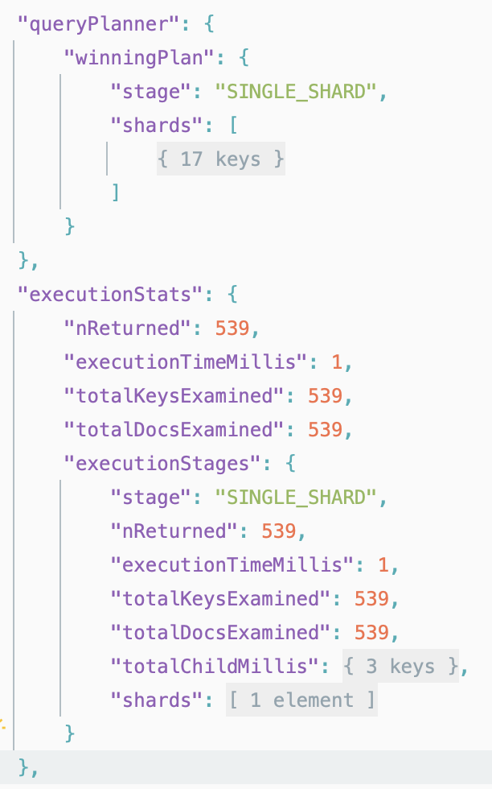
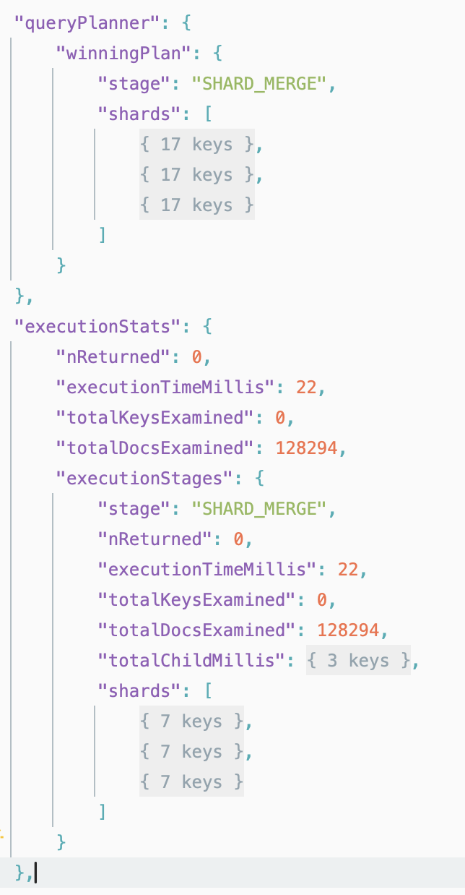
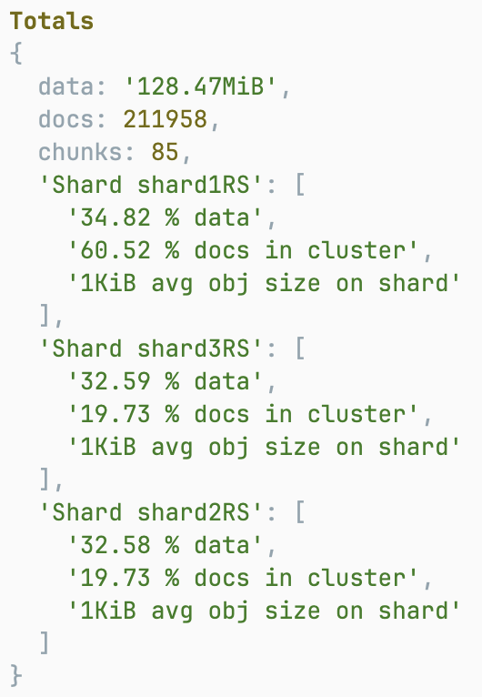

# Catchem - Task 6 - NoSQL cases

## Case 1: MongoDB

**Project Group:** FS_13  

### Objective

The goal was to create a local NoSQL document store using MongoDB Community Server (Version 8.0), containing log data
from the existing Postgres operational database (via PySpark), and simulating a production-like environment with
sharding and replication.

---

## Steps Taken

### Step 1: Installation and Set-up

To simulate the distributed environment locally, I utilized Docker and Docker Compose. This approach allowed us to
deploy multiple MongoDB 8.0 instances cleanly without installing them directly as services on the host machine. We
defined the necessary containers for config servers, shards, and the router in a `docker-compose.yml` file.

### Step 2: Prepare Your Data

Data was extracted from the Postgres operational database and transformed into a nested JSON format using PySpark (
`export_data_in_json_file.ipynb`).

- I joined the `treasure` data with `city` and `country` tables to include detailed location information (city name,
  country name, postal code, and coordinates).
- I aggregated the `stage` data into nested arrays for each treasure.
- **Why this structure?** MongoDB excels at document-based models. Nesting related data (1-to-N relationships like
  stages) under a single `treasure_id` reduces the need for expensive joins and allows for atomic updates to a
  single treasure entity.
- The final processed DataFrame was exported as a JSON file (`treasure_export/treasure.json`) ready for import.

### Step 3: Configure the Sharded MongoDB Cluster

I simulated a distributed database system using the following Docker containers:

- **1 Config Server** (as a replica set `configRS`) running on port 27019.
- **3 Shards**, each consisting of a 2-node replica set (`shard1RS`, `shard2RS`, `shard3RS`) running on port 27018.
- **1 Mongos Router** running on port 27017 to manage routing and queries.

I used an automation script (`init-mongo-cluster.sh`) that uses `mongosh` to:

1. Initiate the config replica set (`rs.initiate()`).
2. Initiate each of the 3 shard replica sets.
3. Wait for the router to be ready and add the shards to the router (`sh.addShard()`).

### Step 4: Load Data into MongoDB

The exported `treasure.json` file was copied into the `mongo-router` container.
Before importing the data, I enabled sharding on the new database:

Connect to `mongos`:

```bash
docker exec -it mongo-router mongosh --port 27017
```

Then run the following commands:

```shell
use catchem
sh.enableSharding("catchem")

// Create an index on the shard key
db.treasures.createIndex({"location.country_name": 1, "location.city_name": 1, "id": 1})

// Shard the collection
sh.shardCollection("catchem.treasures", {"location.country_name": 1, "location.city_name": 1, "id": 1})
```

Once sharding was configured, I used `mongoimport` to load the JSON file into the `catchem` database under the
`treasures` collection:

```bash
mongoimport --port 27017 --db catchem --collection treasures --file /tmp/treasures.json
```

**Shard Key Choice:**

- **Key:** `{ "location.country_name": 1, "location.city_name": 1, "id": 1 }` (Compound)
- **Why:** For filtering based on country and city it would be faster. By putting country and city first, all treasures
  for a specific city are kept together on the same shard. The router immediately knows which shard holds the data for a
  given location, enabling fast targeted queries rather than slow scatter-gather queries across all shards.
  However, `country_name` and `city_name` together do not have enough uniqueness (cardinality). If one city gets a
  massive number of treasures, the chunk for that city would become a "jumbo chunk" that cannot be split or migrated.
  Adding the unique `id` at the end of the compound key guarantees that MongoDB can still split the chunks into smaller
  pieces using the `id`, ensuring long-term scalability and better data distribution while still optimizing our most
  common geographic query patterns.

### Step 5: Query and Explore

I used `mongosh` connected to the router to verify the data and confirm that sharding was functioning.

---

# Example Queries and checking the distribution of data

## 1. Filter treasures by country:

```shell
db.treasures.find({"location.country_name": "Belgium"}).explain("executionStats")
```

```shell
docker exec mongo-router mongosh "mongodb://localhost:27017/catchem" --quiet --eval '
JSON.stringify(
  db.treasures.find({
    "location.country_name": "Belgium"
  }).explain("executionStats"),
  null,
  4
)
' > 04-mongodb-nosql/treasures_export/query_results/explain_result1.json

```



as you can see, the query is targeted to a single shard, and the execution stats show that only one shard was involved
in the query, confirming that our shard key choice allows for efficient routing based on location.

## 2. Find treasures that have a specific difficulty level and terrain:

```shell
db.treasures.find({
    "difficulty": {$size: 3},
    "terrain": {$gte: 4}
}).explain("executionStats")
```

```shell
docker exec mongo-router mongosh "mongodb://localhost:27017/catchem" --quiet --eval '
JSON.stringify(
  db.treasures.find({
    difficulty: { $size: 3 },
    terrain: { $gte: 4 }
  }).explain("executionStats"),
  null,
  4
)
' > 04-mongodb-nosql/treasures_export/query_results/explain_result2.json
```



as you can see, the query is a scatter-gather query that targets all shards because the filter conditions are on fields
that are not part of the shard key. This results in a less efficient query since it has to check all shards for matching
documents. This highlights the importance of choosing a shard key that aligns with common query patterns to avoid
scatter-gather queries and ensure efficient data retrieval.

## 3. Verify Sharding Distribution:

The output of `getShardDistribution()` confirms that data chunks are distributed across `shard1RS`, `shard2RS`, and
`shard3RS`. MongoDB balances by the number of chunks. With hashed sharding enabled, as data grows, chunks are
automatically split and the balancer moves them to equalize the load across the 3 shards.

```javascript
db.treasures.getShardDistribution()
```



---
# Replication Test

To verify that replication is actively working in the MongoDB setup, we can insert a document into the **Primary** node
of a shard and then read it from the **Secondary** node.

Find the primary node of the shard:

```bash
docker exec -it mongo-shard1-a mongosh --port 27018 --quiet --eval "rs.isMaster().primary"
```

In this setup, `mongo-shard1-a` is the primary for `shard1RS`, and `mongo-shard1-b` is the secondary.

**1. Insert data into the Primary node:**

```bash
docker exec -it mongo-shard1-a mongosh --port 27018 --eval '
  db.getSiblingDB("replication_test").test_collection.insertOne({
    message: "Hello from Primary!", 
    timestamp: new Date()
  });
'
```

**2. Read the data from the Secondary node:**
By default, MongoDB prevents reading from secondary nodes. We explicitly allow it using `rs.secondaryOk()` to check if
the data replicated successfully:

```bash
docker exec -it mongo-shard1-b mongosh --port 27018 --eval '
  rs.secondaryOk(); 
  db.getSiblingDB("replication_test").test_collection.find().toArray();
'
```

*If replication is working correctly, the document inserted into the primary node will be returned here.*

The Deprecation Warning: MongoDB is letting you know that rs.secondaryOk() is an older syntax. It automatically
translated it to .setReadPref("primaryPreferred") for you. This tells the database: "I know this isn't the primary node,
but I prefer to read from it anyway."

**3. Check Replication Status:**
To monitor the health and lag of the replication, you can check the built-in status report on any node:

```bash
docker exec -it mongo-shard1-a mongosh --port 27018 --eval "rs.status()"
```

*Look for `mongo-shard1-a:27018` having `stateStr: PRIMARY` and `mongo-shard1-b:27018` having `stateStr: SECONDARY`,
both with `health: 1`.*

---
# some other useful commands

1. **Check the Databases on the Router:**
```shell
docker exec -it mongo-router mongosh --port 27017 --eval 'show dbs'
```
