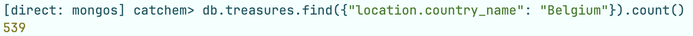
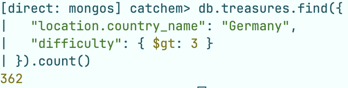
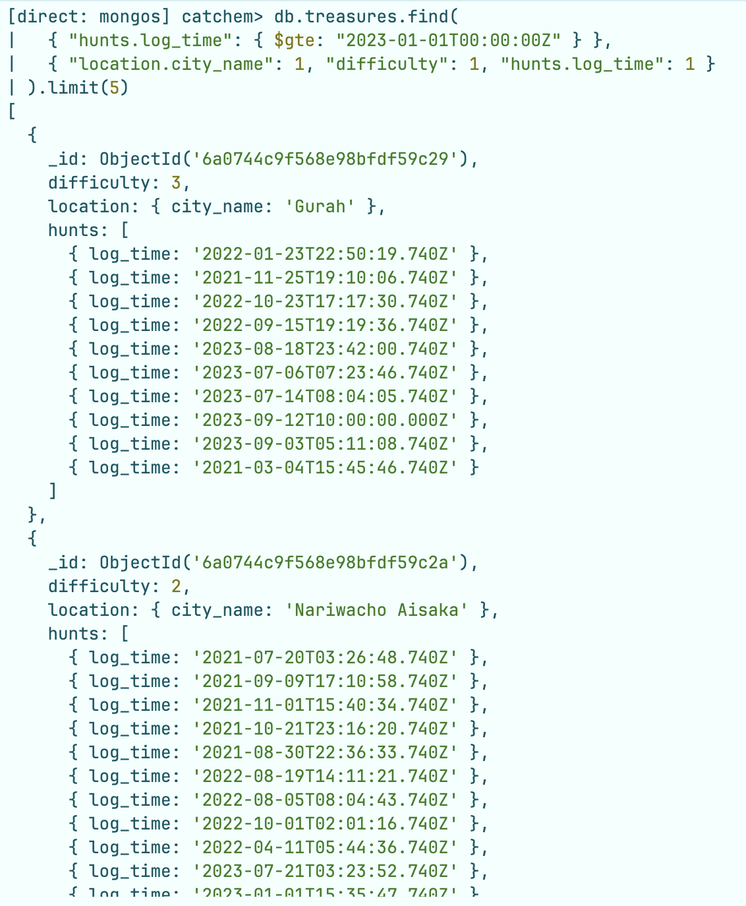
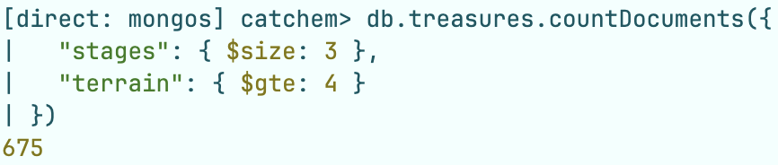
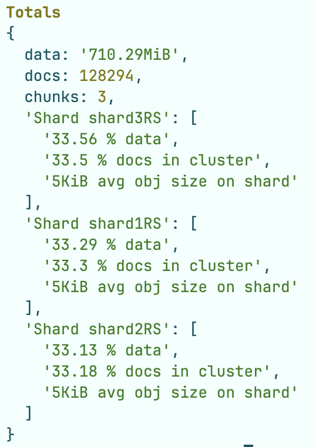

# Catchem - Task 6 - NoSQL cases

## Case 1: MongoDB

**Project Group:** FS_13  

### Objective

The goal was to create a local NoSQL document store using MongoDB Community Server (Version 8.0), containing log data
from the existing Postgres operational database (via PySpark), and simulating a production-like environment with
sharding and replication.

---

### Steps Taken

#### Step 1: Installation and Set-up

To simulate the distributed environment locally, I utilized Docker and Docker Compose. This approach allowed us to
deploy multiple MongoDB 8.0 instances cleanly without installing them directly as services on the host machine. We
defined the necessary containers for config servers, shards, and the router in a `docker-compose.yml` file.

#### Step 2: Prepare Your Data

Data was extracted from the Postgres operational database and transformed into a nested JSON format using PySpark (
`export_data_in_json_file.ipynb`).

- I joined the `treasure` data with `city` and `country` tables to include detailed location information (city name,
  country name, postal code, and coordinates).
- I aggregated the `treasure_log` (hunts) and `stage` data into nested arrays for each treasure.
- **Why this structure?** MongoDB excels at document-based models. Nesting related data (1-to-N relationships like
  stages and logs) under a single `treasure_id` reduces the need for expensive joins and allows for atomic updates to a
  single treasure entity.
- The final processed DataFrame was exported as a JSON file (`treasure_export/treasure.json`) ready for import.

#### Step 3: Configure the Sharded MongoDB Cluster

I simulated a distributed database system using the following Docker containers:

- **1 Config Server** (as a replica set `configRS`) running on port 27019.
- **3 Shards**, each consisting of a 2-node replica set (`shard1RS`, `shard2RS`, `shard3RS`) running on port 27018.
- **1 Mongos Router** running on port 27017 to manage routing and queries.

I used an automation script (`init-mongo-cluster.sh`) that uses `mongosh` to:

1. Initiate the config replica set (`rs.initiate()`).
2. Initiate each of the 3 shard replica sets.
3. Wait for the router to be ready and add the shards to the router (`sh.addShard()`).

#### Step 4: Load Data into MongoDB

The exported `treasure.json` file was copied into the `mongo-router` container.
Before importing the data, I enabled sharding on the new database:

```javascript
use catchem
sh.enableSharding("catchem")

// Create an index on the shard key
db.treasures.createIndex({"treasure_id": "hashed"})

// Shard the collection
sh.shardCollection("catchem.treasures", {"treasure_id": "hashed"})
```

Once sharding was configured, I used `mongoimport` to load the JSON file into the `catchem` database under the
`treasures` collection:

```bash
mongoimport --port 27017 --db catchem --collection treasures --file /tmp/treasures.json
```

**Shard Key Choice:**

- **Key:** `treasure_id` (Hashed)
- **Why:** Since the goal is even distribution and I have 3 shards, a hashed shard key on a unique identifier like
  `treasure_id` ensures that data is spread uniformly across the cluster. This prevents "hot shards" during high-volume
  inserts. Because I nested stages and logs inside the treasure document, related data inherently stays together on the
  same shard, avoiding cross-shard query penalties for typical treasure lookups.

#### Step 5: Query and Explore

I used `mongosh` connected to the router to verify the data and confirm that sharding was functioning.

---

## Example Queries

1. Find treasures in a specific city:

```javascript
db.treasures.find({"location.city_name": "Antwerp"})
```

2. Filter treasures by country:

```javascript
db.treasures.find({"location.country_name": "Belgium"}).count()
```

3. Find difficult treasures (difficulty > 3) in a specific country:

```javascript
db.treasures.find({
  "location.country_name": "Germany",
  "difficulty": { $gt: 3 }
}).count()
```

4. Find treasures that have been hunted at least once since 2023, projecting only relevant fields:

```javascript
db.treasures.find(
  { "hunts.log_time": { $gte: "2023-01-01T00:00:00Z" } },
  { "location.city_name": 1, "difficulty": 1, "hunts.log_time": 1 }
).limit(5)
```

5. Find treasures with exactly 3 stages and a high terrain score, returning the count:

```javascript
db.treasures.find({
  "stages": { $size: 3 },
  "terrain": { $gte: 4 }
})
```

6. Verify Sharding Distribution:
The output of `getShardDistribution()` confirms that data chunks are distributed across `shard1RS`, `shard2RS`, and
`shard3RS`. MongoDB balances by the number of chunks. With hashed sharding enabled, as data grows, chunks are
automatically split and the balancer moves them to equalize the load across the 3 shards.


```javascript
db.treasures.getShardDistribution()
```



